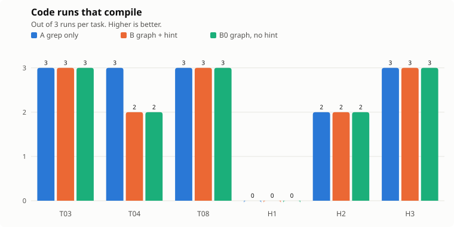
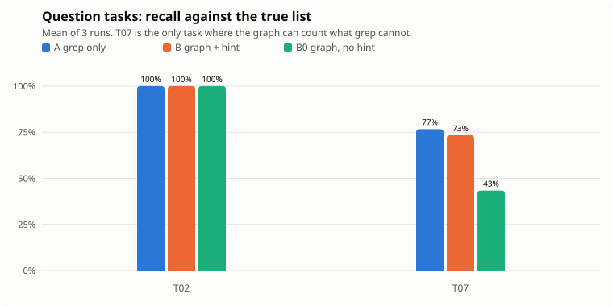
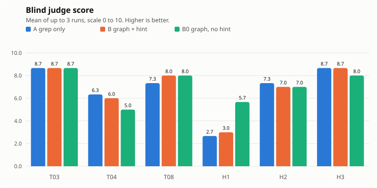
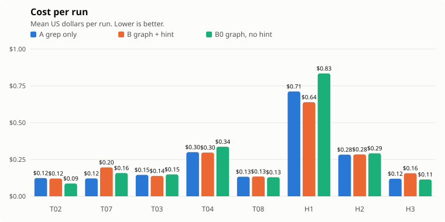

# Does a jQAssistant code graph help a coding agent?

An experiment on Apache Pulsar v4.2.5. A Sonnet 5.5 coding agent worked on the same eight tasks in three setups. The question was whether a Neo4j graph of the code base, built with [jQAssistant](https://jqassistant.github.io/) and served through an MCP server, makes the agent better.

**Short answer: not in general.** On seven of eight tasks the graph made no measurable difference. It clearly helped on none and cost slightly more on some. It shone only on counting dependents across the whole code base, and only when the prompt told the agent about the graph.

| Setup | What the agent has |
|---|---|
| **A** | File tools, grep and bash only |
| **B** | A, plus the Neo4j MCP server (read-only) and a prompt hint describing the graph schema |
| **B0** | A, plus the Neo4j MCP server, with no hint |

The experiment has 72 runs in total: 8 tasks × 3 setups × 3 repetitions.

## Results

| Task | What it asks | Compiles A / B / B0 | Judge A / B / B0 | Other |
|---|---|---|---|---|
| T02 | Implementers of `Topic` | n/a | n/a | Recall 100% in all setups |
| T07 | Top-10 most depended-on classes | n/a | n/a | Recall 77% / 73% / 43% |
| T03 | Add an interface method everywhere | 3/3, 3/3, 3/3 | 8.7 / 8.7 / 8.7 | |
| T04 | Rename `NamespaceBundle.getNamespaceObject` | 3/3, 2/3, 2/3 | 6.3 / 6.0 / 5.0 | Most runs kept a delegate with the old name |
| T08 | Add a broker config option | 3/3, 3/3, 3/3 | 7.3 / 8.0 / 8.0 | Prompt contradicted itself on `conf/` |
| H1 | Rename `Position.getLedgerId` | 0/3, 0/3, 0/3 | 2.7 / 3.0 / 5.7 | Fails everywhere |
| H2 | Rename `Subscription.getName` | 2/3, 2/3, 2/3 | 7.3 / 7.0 / 7.0 | |
| H3 | Rename `StickyKeyConsumerSelector.select` | 3/3, 3/3, 3/3 | 8.7 / 8.7 / 8.0 | |

<picture>
  <source media="(prefers-color-scheme: dark)" srcset="docs/charts/compiles-dark.svg">
  
</picture>

<picture>
  <source media="(prefers-color-scheme: dark)" srcset="docs/charts/recall-dark.svg">
  
</picture>

<picture>
  <source media="(prefers-color-scheme: dark)" srcset="docs/charts/judge-dark.svg">
  
</picture>

<picture>
  <source media="(prefers-color-scheme: dark)" srcset="docs/charts/cost-dark.svg">
  
</picture>

### Where the graph shone, failed and made no difference

- **Shone: ranking by dependents (T07).** One Cypher query counts what grep has to estimate. In a single pilot run B got all ten right. Over three runs B averaged 73% against 77% for A, so the win did not hold. B0, without the hint, was worst at 43%.
- **Failed: the hardest rename (H1).** No run in any setup compiled. Agents renamed unrelated `getLedgerId()` methods (including generated protobuf code) and missed call sites. The graph setups left fewer compile errors in some runs (3, 2 and 6 error locations for B0 against 10 each for A), but did not prevent the over-renaming.
- **No difference:** T02, T03, T08, H3 and mostly H2 and T04. Grep finds these in one or two calls. Agents often skipped the graph even when it was available.

## Caveats

- Three runs per cell is a small sample. Only B0 on T07 stands clearly apart.
- The graph is built from the released jars. It has no test code and no line numbers, and it cannot see unmerged changes.
- The compile check covers `src/main` of a few modules, built in a JDK 21 Docker container. It would miss callers elsewhere, but every setup is checked the same way.
- The true answers for T02 and T07 come from the same graph that the graph setups query, which favors them.
- The blind judge is Opus 5.5, which sees only the task and the diff and cannot search the repository. Its "incomplete" notes are partly guesses. Two judgments (`H2-B-3`, `H2-B0-2`) failed repeatedly and are missing from the means.
- Task T08's prompt asked for an edit in `conf/broker.conf` while limiting edits to `src/main`. Several runs in every setup skipped the config file.
- The rename tasks keep the old method as a delegate if an interface requires it. That compiles but is not a true rename.

## Reproduce

Requires Docker, Java 17+, Maven, `uv`, Python 3 and the `claude` CLI.

1. `git clone --depth 1 --branch v4.2.5 https://github.com/apache/pulsar.git pulsar`
2. `docker compose -f setup/docker-compose.yml up -d` starts Neo4j 5.
3. Download the jQAssistant 2.9.1 CLI (`jqassistant-commandline-neo4jv5`) from Maven Central into `setup/cli/`, download the Pulsar module jars into `setup/jars/`, then run `jqassistant scan -f jars` and `jqassistant analyze` from `setup/`. The config is `setup/.jqassistant.yml`.
4. Prime the Maven cache by installing `pulsar-common`, `pulsar-broker-common` and `pulsar-broker` with `-am` in a `maven:3.9-eclipse-temurin-21` container using the volume `pulsar-m2`. The compile check in `harness/compile.sh` runs offline against it.
5. `python harness/run.py T02,T07,T03,T04,T08,H1,H2,H3 A,B,B0 3` runs the experiment.
6. `python harness/judge.py` scores the diffs. `python harness/make_charts.py` redraws the charts.

## Layout

| Path | Contents |
|---|---|
| `setup/` | Neo4j compose file and jQAssistant configuration |
| `mcp/` | MCP configs for the setups: `none.json`, `neo4j.json` |
| `tasks/tasks.json` | The eight tasks with prompts and ground truth |
| `harness/` | Runner, compile check, blind judge and chart script |
| `results/summary.csv` | One row per run: cost, turns, compile result, recall |
| `results/runs.json` | The same rows as JSON, with judge scores |
| `results/judgments.json` | The blind judge's score and notes per diff |
| `results/raw/` | Raw agent output, diffs and compile logs per run |
| `results/pilot/`, `results/round1/` | The earlier two-task pilot and the first-round summary |
| `docs/charts/` | Charts used above, in light and dark |

The chart colors are validated categorical slots (blue, orange, aqua). Aqua is below 3:1 contrast on the light surface, so every bar carries a direct value label.
